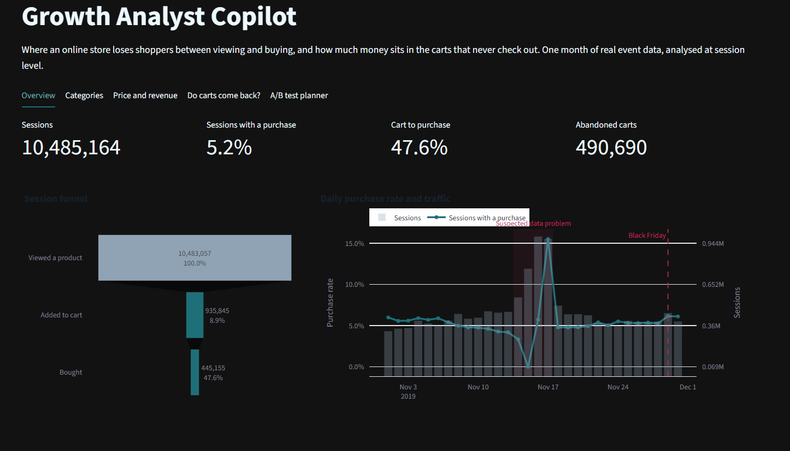
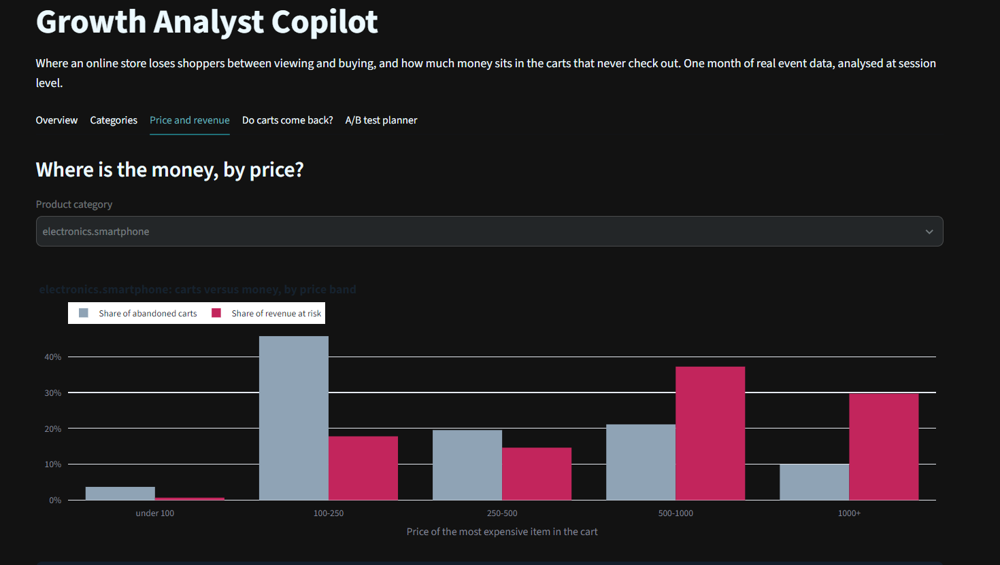

# Growth Analyst Copilot

**Live dashboard:** https://growth-analyst-copilot-rbgtffobapdvnnmzqdm29m.streamlit.app/

Where does an online store lose shoppers between viewing and buying, and how much money sits in the carts that never check out? This project answers that with session-level analysis of one month of real e-commerce event data (67.5M events, 13.8M sessions), an interactive Streamlit dashboard, and an A/B test design for the biggest opportunity.

## Key findings

1. **The funnel leaks after the cart.** On normal days, 47.6% of carted sessions end in a purchase, so about 491K carts were abandoned (10.5M sessions, 5.2% with a purchase).
2. **Part of the data is broken, and it matters.** On 14-17 Nov the event log is unreliable: 15 Nov has 255K carted sessions and exactly 1 purchase. These four days hold 46% of all carted sessions and 55% of the abandoned carts. Left in, they inflate abandoned carts from 491K to 1.09M and pull cart-to-purchase down from 47.6% to 37.2%. The dashboard has a toggle to compare both views.
3. **Smartphones priced 500 or more hold most of the money.** In the smartphone category, carts priced 500+ are 31% of abandoned carts but 67% of the revenue at risk (about 49M of 74M price units).
4. **Most of that money does not come back.** Of 19,192 abandoned smartphone carts priced 500+, 11.5% of shoppers bought the same phone within 7 days and 21% bought any phone, so about 79% of the cart value shows no repeat purchase. This is a rough estimate (see limitations).
5. **An A/B test is designed for it.** Minimum detectable lift of 2 percentage points, 80% power, 5% significance: about 9,600 shoppers per group over at least 7 days. The lift in the included simulation is assumed, so it demonstrates the method, not a real effect.

## How it works

- `build_aggregates.py` uses DuckDB to boil 67.5M events down to small summary tables (funnel, daily trend, categories, price bands). Each is built twice: with all days and without 14-17 Nov.
- `build_recovery.py` finds each abandoned cart and checks whether the same shopper bought later, from 1 hour to 7 days afterwards.
- `app/app.py` is a Streamlit and Plotly dashboard that reads only the small tables, so it loads instantly and does not need the 9 GB dataset. It has a funnel overview, category and price-band views, a "do carts come back?" tab and an A/B sample-size planner.
- `ab_test.py` calculates the sample size and checks power and false-positive rates by simulation.

## Run it

The summary tables are included, so the dashboard runs without the raw data:

    pip install -r requirements.txt
    python -m streamlit run app/app.py

To rebuild from scratch, download `2019-Nov.csv` from the Kaggle dataset below, put it in `data/`, then run `python 01_load.py`, `python build_aggregates.py` and `python build_recovery.py`.

## Limitations

- One month of data. The recovery analysis uses carts from 12 days (1-6 and 18-23 Nov), so each cart has a full 7-day follow-up that avoids the suspect days.
- Shoppers are followed by user ID only. A purchase on another device or account looks like a lost cart, and a "return" within the first hour may be one visit split into two sessions.
- Revenue at risk uses the price of the most expensive item in each cart and is an upper bound. The recovery analysis credits the full cart price even if the shopper later buys a cheaper item.
- The cause of the 14-17 Nov problem is unknown (a tracking fault, bot traffic or a real event).
- Prices are in the dataset's own units; no currency is given.
- The dataset has no real experiment, so the A/B test is a design and simulation only.

## Data and tools

Data: [eCommerce behavior data from multi category store](https://www.kaggle.com/datasets/mkechinov/ecommerce-behavior-data-from-multi-category-store) (Kaggle, collected by the Open CDP project). Data files belong to the original authors and are not included in this repo.

Tools: Python, DuckDB, pandas, Plotly, Streamlit, statsmodels.
